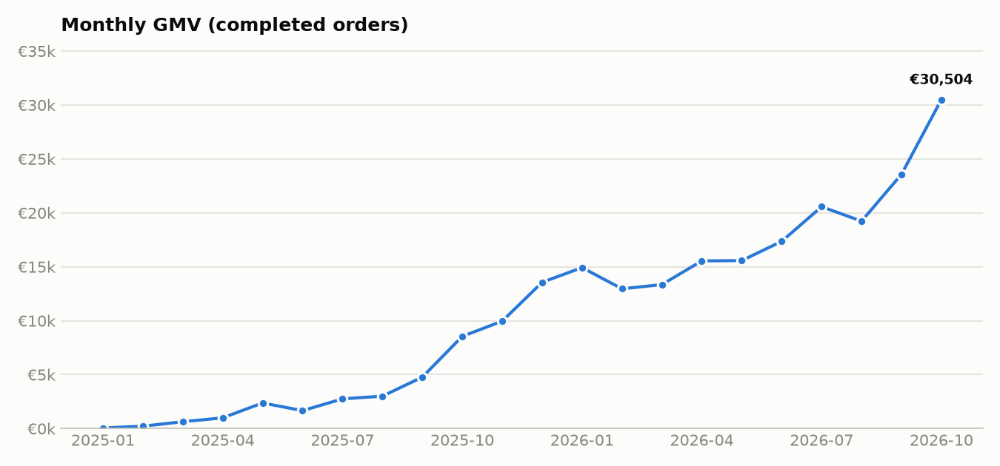
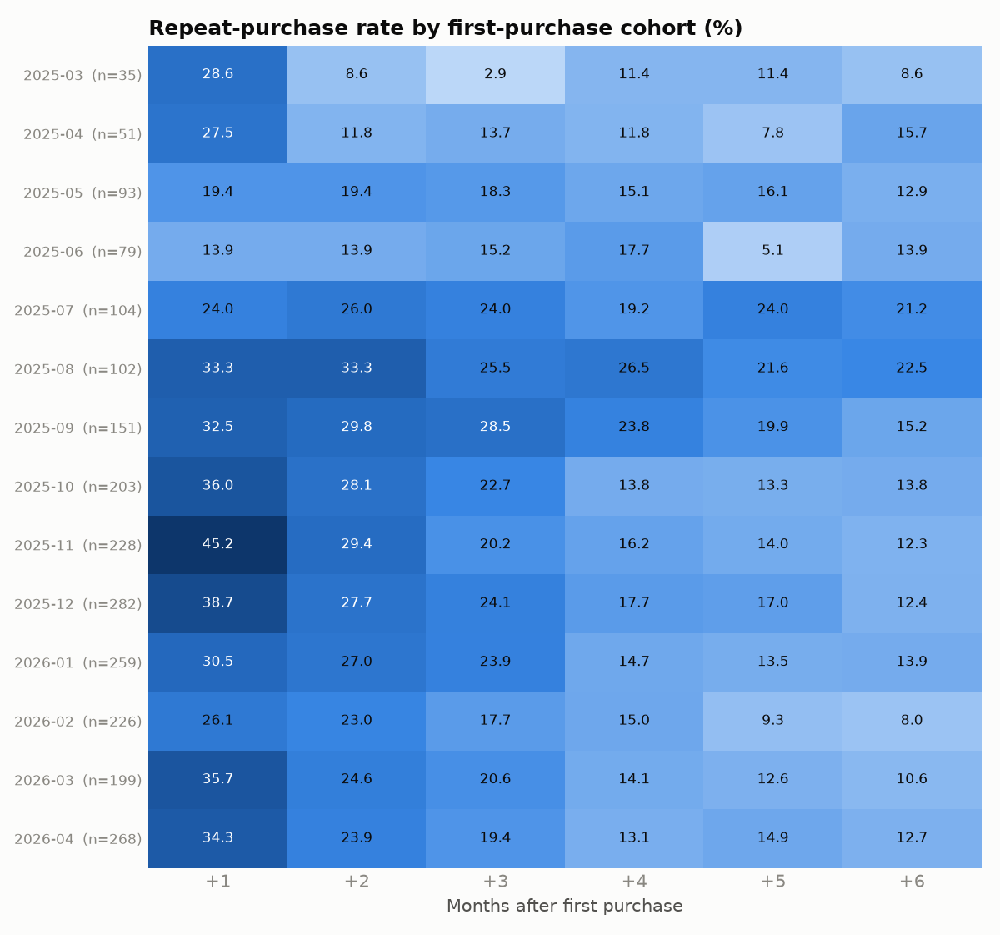
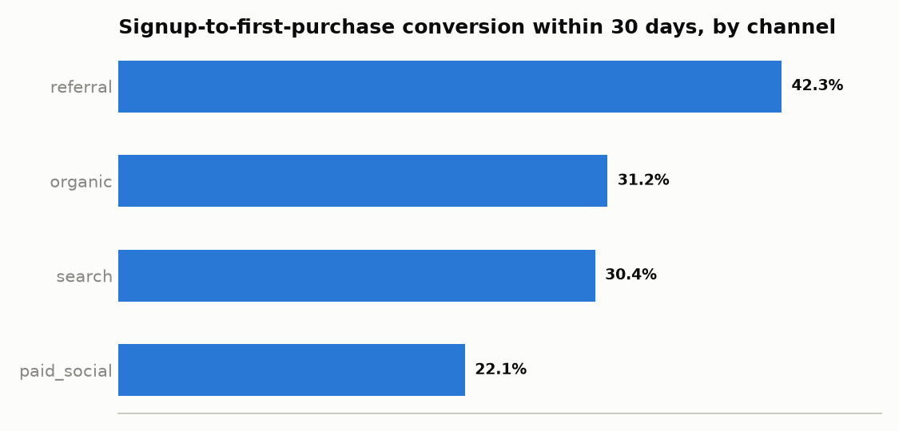
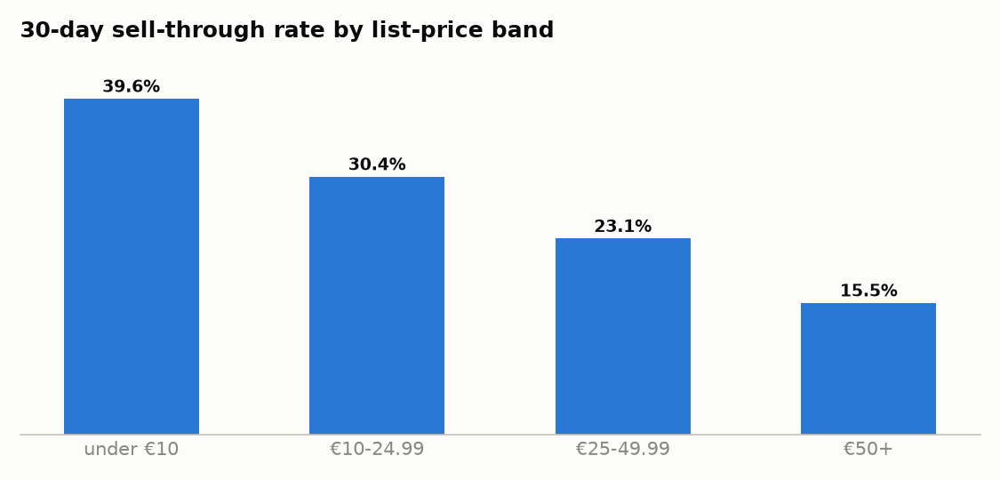

# Marketplace SQL Analysis

SQL analysis of a **simulated second-hand marketplace** (8,000 users, 40,000 listings, 16,670 orders, Jan 2025 – Oct 2026). Seven queries answer the questions a marketplace analytics team asks every week: growth, category mix, supply concentration, buyer retention, channel quality and sell-through.

> **The data is synthetic.** It is generated by `generate_data.py` with a fixed seed, using assumptions I chose (growth, seasonality, price/sales relationships). No real company or customer data is used. Absolute numbers therefore reflect those assumptions; the point of the project is the **SQL and the analytical reasoning**, not the business facts.

## Findings (on this dataset)



**Growth and seasonality** (`01`): GMV reached €30.5k in Oct 2026, 3.6x Oct 2025, on 4.0x the orders. Since May 2025, average order value has stayed in a €13–17 band, so growth comes from volume, not basket size. December 2025 grew +36% month over month, while February 2026 fell 13% and August 2026 fell 6.5%.

**Category mix** (`02`): Women's clothing is 40% of orders and 35% of GMV. Electronics is only 2% of orders but 6.5% of GMV, with an average order of €49.55 against €8.38 in Kids. Buyers negotiate about the same everywhere (11–13% below list price).

**Supply concentration** (`03`, `04`): The top 10% of selling sellers generate 45.6% of GMV, the top 30% generate 74.9%, and the bottom half generate just 11.3%. No single seller holds more than 6.1% of any country's GMV, so concentration is a long-tail effect rather than dependence on one seller.



**Buyer retention** (`05`): In cohorts of 100+ buyers, 24–45% buy again the following month, falling to roughly 8–22% by month 6. The November 2025 cohort had the strongest month-1 repeat rate (45.2%). Cohorts under 30 buyers are excluded because their percentages are noise.



**Channel quality** (`06`): Referral users convert to a first purchase within 30 days at 42.3%, nearly 2x paid social (22.1%). Organic (31.2%) and search (30.4%) sit in between.



**Sell-through** (`07`): 39.6% of items under €10 sell within 30 days, versus 15.5% of items at €50+.

## What I would do next
- Compare paid-social acquisition cost with referral cost. A channel with half the conversion needs less than half the cost per signup to pay off.
- Test pricing nudges on €25+ listings, where sell-through drops fastest.
- Check why the Nov 2025 cohort retained best: gifting season, a promotion, or a different mix of buyers.
- Track the top-decile sellers separately (support, fees, churn risk), since they carry almost half the GMV.

## SQL techniques used

| Query | Question | Techniques |
|---|---|---|
| `01_monthly_gmv` | How fast are we growing? | CTE, `LAG()`, moving-average window frame |
| `02_category_mix` | Which categories drive revenue? | JOIN, aggregate-over-window for share of total |
| `03_top_sellers_by_country` | Who are the power sellers per market? | `RANK() OVER (PARTITION BY ...)`, partitioned `SUM()` |
| `04_seller_concentration` | How concentrated is supply? | `NTILE()`, cumulative window `SUM()` |
| `05_buyer_cohort_retention` | Do buyers come back? | Chained CTEs, date arithmetic, cohort sizing |
| `06_channel_conversion` | Which channels bring buyers? | `LEFT JOIN`, conditional aggregation |
| `07_sell_through_by_price_band` | How does price affect selling speed? | `CASE` bucketing, time-windowed `LEFT JOIN` |

**Analytical care taken:** only completed orders count towards GMV; queries 05–07 exclude recent users, items and cohorts whose observation window is cut off by the end of the data (right-censoring), so rates are not understated.

## Run it

```bash
pip install -r requirements.txt
python generate_data.py     # creates marketplace.db (SQLite)
python run_analysis.py      # runs queries/*.sql, writes results/*.csv and charts
```

You can also open `marketplace.db` in any SQLite client and run the files in `queries/` directly.

## Project layout

```
generate_data.py    synthetic data generator (seeded, reproducible)
queries/            the 7 SQL files, each with its question and techniques in comments
run_analysis.py     runs the queries, saves CSVs, draws the charts
results/            CSV output of each query + PNG charts
```

## Data model

`users(user_id, signup_date, country, acquisition_channel)` · `items(item_id, seller_id, category, brand_tier, list_price, listed_at)` · `orders(order_id, item_id, buyer_id, order_date, sale_price, status)` with status `completed`, `cancelled` or `refunded`. Each item sells at most once.
